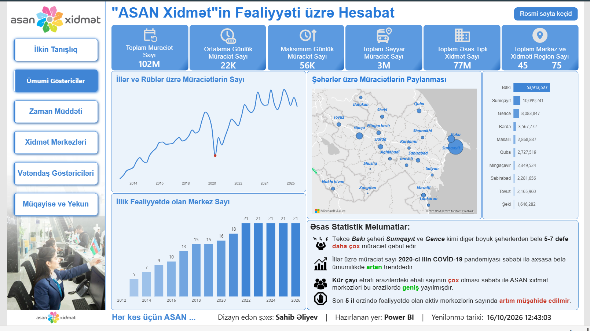
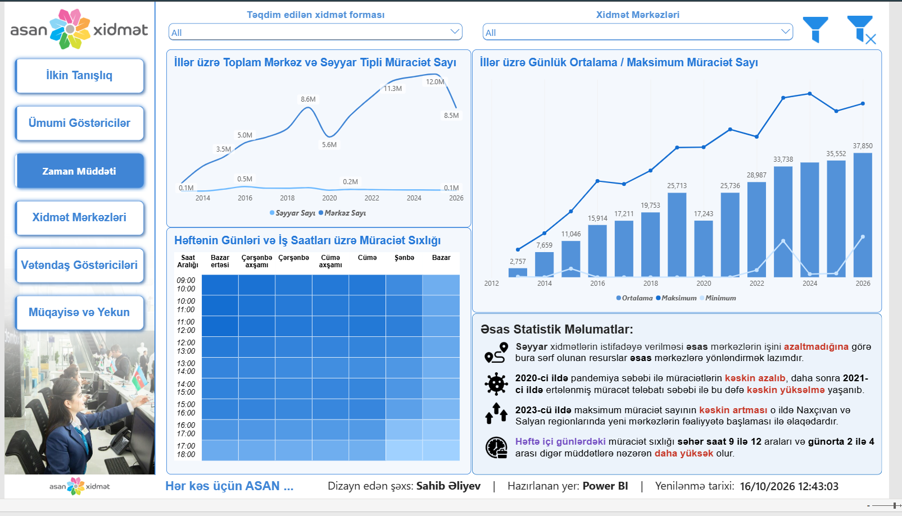
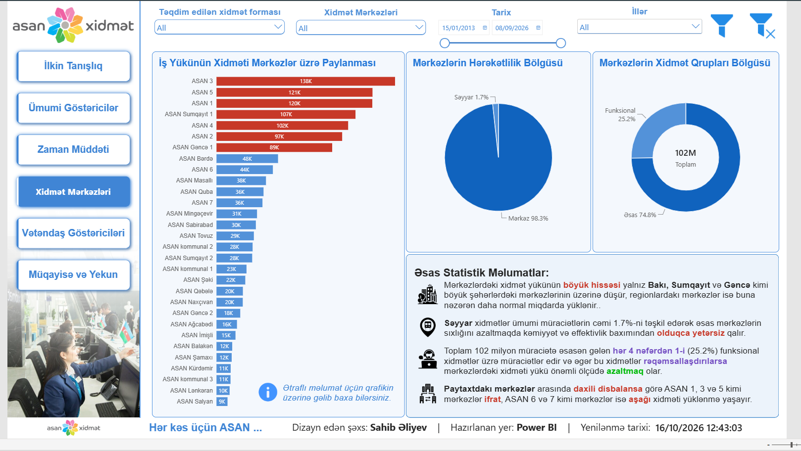
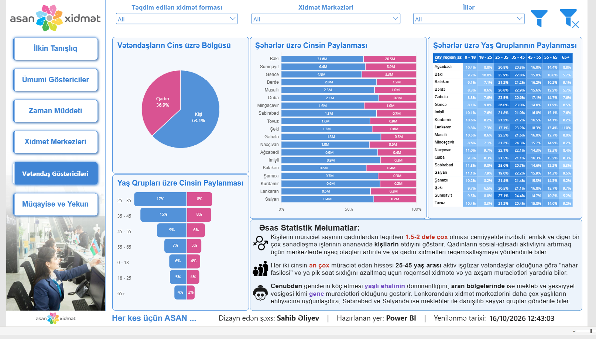
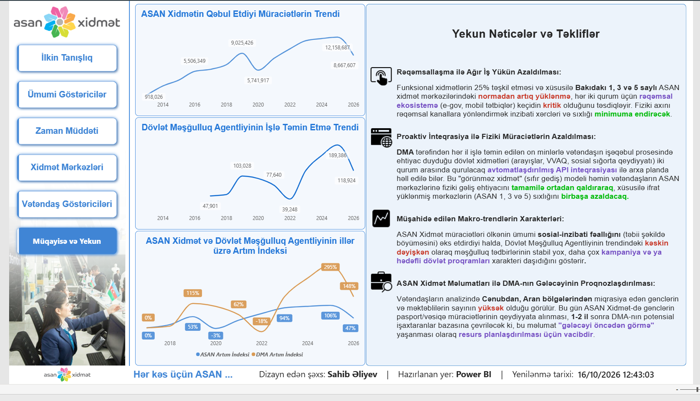
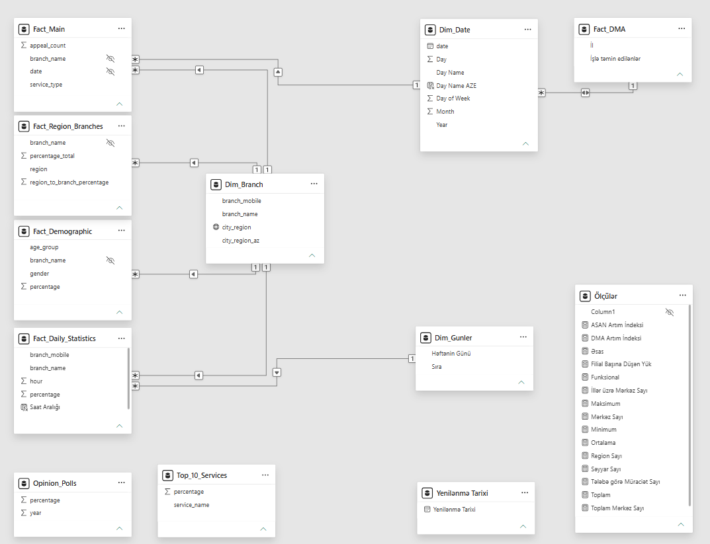

# ASAN-Service-Performance-Dashboard
An end-to-end Power BI analytics dashboard analysing over 102 million service records of ASAN Service and benchmarking macro-trends against the State Employment Agency (DMA). Features advanced DAX, Galaxy Schema modelling, and actionable strategic insights for operational optimisation and digitalisation.

## 📌 Project Overview
This end-to-end Business Intelligence project was developed as the Final Project for the Power BI Module of the **"Data Analytics & GenAI"** program at **ABB Tech Academy** (Evaluated at 100/100). The dashboard provides a comprehensive analysis of **ASAN Xidmət** (State Agency for Public Service and Social Innovations) operational dynamics, citizen demographics, and workload distribution.

Furthermore, it establishes a strategic benchmark against the **State Employment Agency (DMA)**, utilising multi-variable historical data to uncover macro-trends and provide actionable "Zero-Visit" digital transformation strategies.

**Data Scope:** 2013–2026 | 45 Centers | 75 Regions | 102 Million+ Applications

  

---

## ⚙️ Technical Architecture & Workflow

### 1. Data Extraction & Transformation (ETL via Power Query)
- Extracted 6 raw datasets from the official Open Data Portal (`opendata.vxsida.gov.az`) and DMA statistics.
- Handled over **202,000+ rows** of core fact data.
- Performed rigorous data cleaning, removed hardcoded columns, generated distinct `Dimension` reference tables, and optimised RAM usage by disabling the `Enable Load` feature for staging queries.

### 2. Data Modelling (Galaxy Schema)
- Designed a **Galaxy Schema (Fact Constellation)** to handle multiple independent fact tables (`Fact_Main`, `Fact_DMA`, `Fact_Demographic`, etc.) sharing conformed dimensions (`Dim_Date`, `Dim_Branch`).
- Implemented **Poka-Yoke** (mistake-proofing) by hiding foreign keys in Fact tables to enforce proper filter context flow through Dimension tables.

### 3. Advanced DAX Computations
- **Iterators:** Utilised `MAXX`, `MINX`, and `AVERAGEX` alongside `VALUES()` to compute daily extremes and averages across temporal dimensions.
- **Filter Context Manipulation:** Applied `CALCULATE`, `REMOVEFILTERS`, and `ALL` to build a dynamic "Base Year (2017) Growth Index" for benchmarking drastically different data scales.
- ** Optimisation:** Used variables (`VAR`) to cache intermediate query results and `DIVIDE` for safe, error-free ratio calculations.

---

## 🎯 Key Strategic Insights

1. **Workload Imbalance & Digitalisation:** A heavy concentration of physical workload falls on Baku (ASAN 1, 3, 5). With 25.2% of all visits being "Functional Services," aggressive integration into the e-gov ecosystem can significantly reduce physical queues.
2. **Temporal & Demographic Behaviour:** Service centres experience peak pressure between `09:00-12:00` and `14:00-16:00`, dominated by male citizens (63.1%) in the 25-45 age group.
3. **Macro-Trend Benchmarking (Leading Indicators):** While ASAN shows steady organic growth (+106% index), DMA exhibits campaign-driven volatility (+295% index). A surge in youth ID/Passport applications at regional ASAN centres acts as a 1-2 year **Leading Indicator** for future DMA job-seeker volumes.
4. **The "Zero-Visit" Solution:** Recommended building an automated API pipeline between DMA and ASAN to process mandatory employment documents in the background, eliminating physical branch visits for newly employed citizens.

---

## 🖼️ Dashboard Previews

*(Note: Click on the images to view them in full resolution)*

### 1. General Indicators & Geographic Distribution
*(Provides macro-level KPIs, historical volume trends, and interactive mapping of service distribution)*
 

### 2. Time Duration & Heatmap Analysis
*(Uncovers daily and hourly workload peaks to optimize shift planning)*
 

### 3. Branch Workload & Service Types
*(Highlights the disparity between capital and regional centers, and the utilization rate of mobile "Səyyar" services)*
 

### 4. Citizen Demographics
*(Breaks down user behavior by age, gender, and geographical variations)*
 

### 5. Cross-Agency Benchmarking & Strategic Conclusions
*(Compares ASAN vs. DMA growth indices and delivers executive-level operational recommendations)*
 

### 6. Data Model (Galaxy Schema)
*(Behind-the-scenes look at the robust relational data architecture)*
 

